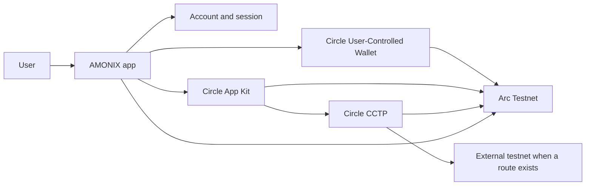

# AMONIX on Arc

**Everyday Money, Onchain**

AMONIX is a user-controlled wallet experience for [Arc](https://docs.arc.io/). It brings everyday payments, assets, and supported DeFi into one app so people can send, receive, request, split, swap, and settle in USDC without assembling a protocol toolkit.

This repository is the **AMONIX Public Edition**. It contains three distinct layers:

1. **Reused production UI/source** — the AMONIX component kit and selected presentation helpers, copied from the private app through an explicit allowlist.
2. **Demo-only simulated functionality** — `/demo/*` screens and `/api/demo/*` fixture APIs. They never sign, never talk to Circle, and never settle onchain.
3. **Private production implementation** — the live wallet, auth, and settlement stack. It is **not** in this repository.

The feature matrix later in this README describes **private production on Arc Testnet**, not what the simulated demo executes.

---

## Product overview

AMONIX is designed for people who want money to feel familiar while remaining onchain:

- **One wallet.** A Circle [User-Controlled Wallet](https://developers.circle.com/wallets/user-controlled) (smart-contract account) on **Arc Testnet**. Users review each action and authorize it before anything is submitted.
- **Everyday payments.** Send, receive, payment requests, split bills, and Scan & Pay live next to portfolio and Activity.
- **Supported DeFi.** Earn, Borrow, and Liquidity when a verified route is available. Stake is visible but unavailable until a verified provider exists.
- **Cross-chain access.** Supported deposits and Circle CCTP bridging can move value toward Arc when a route is shown in the app.
- **Clear status.** Review → authorize → process → receipt → Activity, with real provider and transaction state rather than simulated completion.

The product currently runs on **Arc Testnet**. Do not assume Arc Mainnet or other networks are live unless the app explicitly shows them.

**Vision:** make onchain money as ordinary as a bank app—without hiding that the user remains in control of every authorization.

---

## Status legend

| Status | Meaning |
| --- | --- |
| **Implemented** | Shipped in the current product on Arc Testnet, subject to provider availability. |
| **Experimental** | UI or route exists; execution, coverage, or liquidity may be limited, community-run, or not yet live. |
| **Unavailable** | Screen exists so the product stays honest; the action cannot be completed today. |
| **Planned** | Product intent; not offered to users yet. |

Supported assets, quotes, and DeFi opportunities depend on **routes available at the time of use**. Testnet funds have no mainnet value.

---

## Feature matrix (private production)

Statuses below are for the privately maintained AMONIX product on Arc Testnet. The Public Edition demo only *presents* a subset of those surfaces with fixture data.

| Area | Capability | Status |
| --- | --- | --- |
| Onboarding | Create account, email verification, claim username | Implemented |
| Sign-in | Email one-time code, X, passkey | Implemented |
| Wallet | Circle User-Controlled Wallet (SCA) on Arc Testnet | Implemented |
| Security | Passkey for login and sensitive operations; App Lock after idle | Implemented |
| Language | English and Tiếng Việt | Implemented |
| Home | Balances, shortcuts, incoming requests and splits that need attention | Implemented |
| Portfolio | Tokens, hide balances, allocation view | Implemented |
| Assets | Token list, import ERC-20 by contract, testnet faucet entry | Implemented |
| NFTs | Owned collections, import collection, transfer when supported | Implemented |
| Send | Supported assets to AMONIX users or addresses | Implemented |
| Receive | Arc address + QR | Implemented |
| Receive | Deposit from another supported chain when a route is shown | Implemented |
| Swap | Quotes, slippage, router selection, execution on Arc | Implemented |
| Swap | Community Uniswap V2-style liquidity | Experimental |
| Bridge | Circle CCTP-style USDC path when the app offers a route | Implemented |
| Payment Request | Create, pay, reject, cancel, reminders (AMONIX users) | Implemented |
| Split Bill | Create group bill, pay share, track participants | Implemented |
| Payees | Saved recipients | Implemented |
| AMONIX Pay | Scan & Pay merchant QR in USDC on Arc | Implemented |
| AMONIX Pay | Bank transfer | Planned |
| DeFi Earn | Supply / withdraw supported yield when the provider is available | Implemented |
| DeFi Borrow | Collateral, borrow, repay, health when the provider is available | Implemented |
| DeFi Liquidity | Add / remove liquidity on verified community pools | Experimental |
| DeFi Stake | Visible in DeFi; no verified provider | Unavailable |
| Wallet Tracking | Read-only public addresses; data loads after an explicit open | Implemented |
| Privacy | Shield / private send / unshield screens | Experimental |
| Privacy | Shield, private send, and unshield transactions | Non-operational |
| Activity | Canonical receipts, explorer links, history | Implemented |
| Notifications | In-app events for transfers, requests, splits, and related activity | Implemented |
| Help / About | In-app product copy and Arc connection status | Implemented |
| Arc Mainnet | Documented network; not the active product target | Planned |

---

## Public source structure

| Path | What it is |
| --- | --- |
| `README.md`, `docs/`, `CHANGELOG.md` | Product documentation |
| `PUBLISH_MANIFEST` | Explicit allowlist used to sync this repository |
| `src/components/amonix/` | Production UI primitives (buttons, forms, cards, metrics) |
| `src/components/shared/` | Safe shared presentation (empty states, receive panel, logo) |
| `src/components/ui/` | Base controls used by those primitives |
| `src/components/demo/` | Demo-only adapters (headers, token marks, receipts) |
| `src/app/demo/` | Simulated Home, Assets, Send, Receive, Swap, Requests, Splits, DeFi, Activity |
| `src/app/api/demo/` | Fixture JSON APIs labeled `simulated: true` |
| `src/lib/demo/` | Mock balances and activity |

**Reused from the private app:** AMONIX UI kit, form chrome, feature icons, decimal helpers, and selected presentation components.

**Demo-only:** pages, demo APIs, fixtures, and adapters that replace auth, i18n, and wallet stores.

When an allowlisted private file such as `src/components/amonix/Button.tsx` changes on private `main`, the sync copies **that file only**. Newly added private files are **not** published unless they are added to `PUBLISH_MANIFEST`.

### How to run the public demo

Run these commands from **this repository’s root** (the folder that contains this README). The Public Edition has its own `package.json` and lockfile. Do not install or build it through a parent private app, and do not reuse that app’s `node_modules`.

```bash
npm install
npm run dev
```

Open [http://127.0.0.1:3010](http://127.0.0.1:3010), then **Launch simulated demo**.

`npm run build` produces a production build of the demo only. No Circle credentials, database URL, or wallet device is required. Simulated send posts to `/api/demo/simulate` and returns `{ "simulated": true, "onchain": false }`.

### Demo vs production

| Public Edition | Private production |
| --- | --- |
| Mock balances and receipts | Circle User-Controlled Wallet on Arc Testnet |
| “Simulate send” never hits a chain | User-authorized onchain settlement |
| No login | Email, X, passkey, App Lock |
| This GitHub repository | Privately maintained source |

---

## Onboarding and wallet experience

1. **Create an account** with email. Verification uses a one-time code in the Circle wallet flow.
2. **Claim a username** so other AMONIX users can find you without sharing an address every time.
3. AMONIX **provisions a user-controlled wallet** on Arc Testnet. The user does not paste a seed phrase into the app for this flow.
4. Sign in later with **email**, **X**, or a **passkey**. Passkeys can also be added from Profile.

Typical money movement:

**Review → wallet authorization → processing → receipt → Activity**

Check status reconciles an existing operation. It does not silently create a duplicate payment.

---

## Circle User-Controlled Wallets

AMONIX uses Circle **User-Controlled Wallets**: the user authorizes transactions; AMONIX prepares the review surface and tracks status.

- Wallet type: smart-contract account on **Arc Testnet**.
- Signing UX: Circle wallet PIN / biometrics as presented by Circle, plus AMONIX passkey step for sensitive app operations.
- AMONIX does not publish a custodial “we move funds for you” model in this product.

Circle App Kit is used for supported onchain actions (send estimation, swap/DeFi kits, CCTP bridge) on the Arc Testnet environment.

---

## Arc Testnet

AMONIX currently targets **Arc Testnet**.

| | |
| --- | --- |
| Network | Arc Testnet |
| Chain ID | `5042002` |
| Explorer | [explorer.testnet.arc.io](https://explorer.testnet.arc.io) |
| Gas token | USDC (native gas on Arc) |
| Application USDC | ERC-20 view (6 decimals), same underlying value as native USDC |
| Testnet faucet | [faucet.circle.com](https://faucet.circle.com) |

Arc is a stablecoin-native chain. Fees are shown in **USDC**, not ETH. Mainnet is **not** activated in the product.

Official network references: [Connect to Arc](https://docs.arc.io/arc/references/connect-to-arc), [RPC endpoints](https://docs.arc.io/arc/references/rpc-endpoints).

---

## Passkey and security overview

Public description only—no implementation internals.

- **Passkeys (WebAuthn)** for sign-in and for confirming sensitive operations.
- **Email verification** as an account factor.
- **App Lock** after a period of inactivity on a signed-in device (currently a 30-minute idle window). Unlock does not replace Circle’s own wallet authorization.
- **Transaction protection:** each money-moving action is reviewed in AMONIX and authorized in the wallet flow before submission.
- **Read-only tracking** never signs for a watched address.

AMONIX is a testnet product. Treat it as software under active development, not a regulated bank or a mainnet store of value.

---

## Portfolio and assets

- Home and Assets show **supported holdings** on the AMONIX Arc wallet.
- Users can hide balances, import an ERC-20 by contract address, and open a testnet faucet when they need test USDC.
- NFT collections can be viewed and imported when metadata lookup succeeds.
- Catalog and imported tokens are still bound to **Arc Testnet**. Wrong-network sends can be unrecoverable.

---

## Send, Receive, Swap, Bridge

**Send.** Choose a supported asset, recipient (username, payee, or address), amount; review; authorize.

**Receive.** Arc tab: address and QR. Other-chain tab: a deposit route when a provider path is available. Only send the asset and network the screen names.

**Swap.** Quote supported pairs, inspect rate, fees, and minimum received, choose an available router, set slippage, authorize. Quotes can change before confirmation.

**Bridge.** Cross-chain USDC using **Circle CCTP** / Circle App Kit when the app offers a route (for example, a supported Ethereum testnet toward Arc Testnet). Source and destination progress are tracked in-app. Availability is route-dependent.

---

## Payment Requests and Split Bills

**Payment Request.** One AMONIX user asks another for a specific amount. The other party can pay, reject, or the creator can cancel. Status is visible to both sides.

**Split Bill.** A total is divided across participants. Each person pays their share from AMONIX. Reminders and settlement use the same review/authorize path as other payments.

Both features settle on **Arc Testnet** for supported assets (typically USDC).

---

## Payments (AMONIX Pay)

AMONIX Pay is in-app merchant-style payment in **USDC on Arc**.

- **Scan & Pay (implemented):** scan a supported QR, review amount and destination, authorize, receive an onchain receipt in Activity.
- **Bank transfer (planned):** shown in the app as coming soon.

Always confirm the review screen. Testnet payments are not commercial settlement.

---

## DeFi: Earn, Borrow, Liquidity

Reached from the DeFi hub. Rates, health, and liquidity can change; returns are not guaranteed.

| Product | What users can do | Status |
| --- | --- | --- |
| **Earn** | Supply supported assets to available yield; add more or withdraw when offered | Implemented when the provider is up |
| **Borrow** | Post collateral, borrow, repay; watch health factor | Implemented when the provider is up |
| **Liquidity** | Add or remove liquidity on **verified community Uniswap V2-style** pools | Experimental |
| **Stake** | Explains that no verified Arc staking provider is available | Unavailable |
| **Tracking** | Watch public wallets (see below) | Implemented |

Circle App Kit earn/borrow integrations back the first two when the live kit reports a usable market. If a market is paused or a quote fails, the app shows that state instead of inventing APY.

---

## Privacy

Privacy screens (shield, private send, unshield) exist so the product can present a confidential-balance model later.

**Privacy transactions are non-operational.** Arc private execution is not available yet, and those actions do not move funds. The screens are **experimental / coming soon**, consistent with in-app About.

---

## Activity and notifications

- **Activity** is the system of record for wallet events AMONIX knows about: sends, swaps, bridges, requests, splits, Pay, DeFi, and related receipts.
- Receipts share one visual pattern: status icon, copy, amounts, details, and actions—without a product logo on the card.
- **Notifications** surface application events (incoming request, paid share, transfer, and similar). They are not a raw chain indexer UI.

---

## Tech stack (public)

| Layer | Public Edition | Production (not in this repo) |
| --- | --- | --- |
| App | Next.js, React, TypeScript, Tailwind CSS | Same family |
| UI | `@/components/amonix` primitives | Same primitives plus private screens |
| Demo data | In-repo fixtures + `/api/demo/*` | Live portfolio and Activity |
| Wallet | Not included | Circle User-Controlled Wallets, App Kit |
| Auth | Not included | Email OTP, X, passkeys, App Lock |

Exact production hosting, data stores, and private services are **not** documented here.

---

## Architecture (high level)



See [docs/ARCHITECTURE.md](docs/ARCHITECTURE.md) for a public-level walkthrough.

---

## Screenshots

Add product captures here before publishing a visual README. Suggested set:

| Placeholder | Intended shot |
| --- | --- |
| `docs/images/home.png` | Home — balance and actions |
| `docs/images/send.png` | Send review |
| `docs/images/pay.png` | AMONIX Pay Scan & Pay |
| `docs/images/defi.png` | DeFi hub |
| `docs/images/receipt.png` | Success receipt (no logo on the card) |
| `docs/images/activity.png` | Activity list |

_Screenshot files are not included yet. Add the paths above before a public launch so GitHub does not render broken images._

---

## Public development timeline

Condensed from confirmed project history (2026). Details in [CHANGELOG.md](CHANGELOG.md).

| Period | Milestone |
| --- | --- |
| Sep 2026 | Product foundation; Arc Testnet reads; Circle UCW provisioning; real send, receipts, payment request and split settlement |
| Late Sep 2026 | Account persistence, X and passkey auth, AMONIX Pay Scan & Pay |
| Early Oct 2026 | Earn / Borrow, swap routing, notifications, idle App Lock, bridge |
| Mid Oct 2026 | Bridge recovery, wallet tracking, payment and Safari auth reliability |
| 31 Oct 2026 | Unified brand mark, Circle SDK stack alignment, receipt cards without redundant branding |
| 1 Nov 2026 | Public Edition: UI kit, simulated demo, and allowlisted GitHub sync |

---

## Roadmap

See [docs/ROADMAP.md](docs/ROADMAP.md). Near-term public themes:

- Private execution on Arc when a verified provider exists
- Stake when a verified Arc staking provider exists
- Bank transfer / additional Pay rails
- Arc Mainnet only after an explicit product decision
- Broader assets and deposit routes as providers come online

---

## Limitations

- **Testnet.** Balances are not mainnet money.
- **Route-dependent.** Swap, bridge, Earn, Borrow, and deposits can be unavailable even if the screen exists.
- **Privacy transactions are non-operational.** Screens exist; they do not move funds.
- **Stake is unavailable.** The DeFi tile is visible; staking cannot be completed.
- **Bank transfer is not live.**
- **Community liquidity** is not official Circle infrastructure.
- **Tracking is read-only** and loads on demand.
- This GitHub project does **not** contain the production source tree.

---

## Documentation in this repository

| File | Contents |
| --- | --- |
| [docs/ARCHITECTURE.md](docs/ARCHITECTURE.md) | Public system overview |
| [docs/FEATURES.md](docs/FEATURES.md) | Capabilities and maturity |
| [docs/ROADMAP.md](docs/ROADMAP.md) | Planned vs shipped |
| [CHANGELOG.md](CHANGELOG.md) | Confirmed milestones |
| [THIRD_PARTY_NOTICES.md](THIRD_PARTY_NOTICES.md) | Third-party licenses (not an AMONIX OSS grant) |

---

## Contact and live demo

| | |
| --- | --- |
| Live demo | _Add a public testnet URL here when you are ready to share it._ |
| Contact | _Add a public email or form._ |
| Status | Arc Testnet · product version `0.1.0` |
| Issues | Use this repository’s issue tracker for documentation feedback. |

Do not send mainnet funds, secrets, or recovery phrases to AMONIX channels.

---

## License and source

Production source, keys, and private infrastructure remain **privately maintained**.

Original AMONIX source, documentation, and branding in this repository are **all rights reserved** unless the copyright owner adds a `LICENSE` file. No permissive open-source license is granted for that material.

Third-party packages keep their own licenses. See [THIRD_PARTY_NOTICES.md](THIRD_PARTY_NOTICES.md). Approved examples may be added later; they are not a substitute for the private application.
