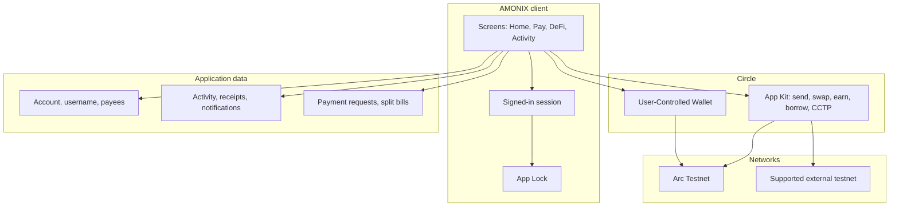
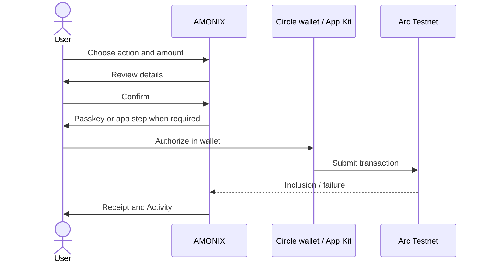

# Architecture

Public-level overview of **AMONIX on Arc**. This is not an operations runbook and does not describe private infrastructure.

The **production implementation is privately maintained**. This repository holds documentation and, later, approved examples only.

---

## What AMONIX is

AMONIX is a consumer wallet application:

- a **web app** the user signs into
- a **Circle User-Controlled Wallet** (smart-contract account) on **Arc Testnet**
- **Circle App Kit** integrations for supported onchain actions
- **application features** around that wallet: payees, payment requests, split bills, notifications, receipts, and read-only tracking

Users stay in control of authorization. AMONIX prepares reviews, submits what the user approved through Circle, and records status in Activity.

---

## Design principles

1. **One product surface.** Payments and DeFi share review, processing, receipt, and Activity patterns.
2. **User-controlled signing.** No silent money movement. Check-status reconciles; it does not retry a new payment on its own.
3. **Arc as the home chain.** Application balances and settlement target Arc Testnet. Other networks appear only as deposit, bridge, or tracking contexts.
4. **Show real state.** Quotes, paused markets, failed authorizations, and pending bridges are reflected rather than simulated as success.
5. **Least surprise on testnet.** Fees in USDC, network labels in the UI, faucet for test funds.

---

## Logical components

### Client

The product is a Next.js / React web app. Signed-in users see Home, Assets, Send, Receive, Swap, Bridge, Pay, DeFi, Privacy (preview), Activity, Profile, and Help.

### Account and session

Email, X, and passkey establish an **AMONIX account**. The session is application-level (who you are in AMONIX). It is separate from Circle’s device and PIN/biometric authorization for the wallet.

### Wallet

On first successful setup, AMONIX associates the account with a **user-controlled SCA on Arc Testnet**. Address, explorer link, and QR are shown in Receive and My Wallet. Token balances use Arc’s USDC model (native gas + ERC-20 view of the same asset).

### App Kit

Supported swaps, earn, borrow, and CCTP bridge steps go through **Circle App Kit** on Arc Testnet. Community Uniswap V2-style pools may appear as an additional liquidity/swap path when verified in-app. That path is not official Circle infrastructure.

### Application features

Payment requests, split bills, payees, notifications, and canonical receipts are **AMONIX product features**. They settle with the same wallet when money moves, but the social graph (who requested whom) is not a public chain protocol.

### Read-only tracking

Users may save public addresses and open holdings/activity for **supported networks**. Tracking does not import keys and does not authorize transactions for those addresses. Data is fetched when the user opens a wallet, not as a silent background control plane.

---

## Transaction path

If authorization is cancelled, the app stays on the review/confirm path. Processing screens can poll or offer **Check status** for in-flight operations (especially bridge).

---

## Networks

| Role | Network | Notes |
| --- | --- | --- |
| Home chain | Arc Testnet (`5042002`) | Wallet, USDC settlement, DeFi, Pay |
| Bridge source (when offered) | Supported Ethereum testnet | Circle CCTP toward Arc |
| Tracking | Selected public networks + Arc Testnet | Read-only |
| Arc Mainnet | Not active | Documented only |

Public explorer: [explorer.testnet.arc.io](https://explorer.testnet.arc.io).

Arc-specific facts that affect the product (from [Arc docs](https://docs.arc.io/)):

- USDC is the **gas token**.
- Application amounts typically use the **ERC-20 USDC** interface (6 decimals).
- There is no ETH-denominated fee UX in AMONIX.

---

## Security boundaries (public)

| Boundary | Intent |
| --- | --- |
| AMONIX session | Proves the browser is signed into an account |
| App Lock | Locks the UI after idle time on that device |
| Passkey | Confirms the user for login and sensitive AMONIX operations |
| Circle UCW | User authorization for onchain actions |
| Tracking | Public data only |

This document does **not** describe key storage, PIN internals, device binding, RPC private configuration, or database layout.

---

## What is intentionally out of scope here

- Environment variables, API keys, and secrets
- Internal HTTP paths and private Git remotes
- Database schemas and hosting vendors
- Exact contract addresses beyond well-known public Arc USDC documentation
- Step-by-step exploit, recovery, or admin procedures

For product capability detail, see [FEATURES.md](FEATURES.md). For what is not shipped yet, see [ROADMAP.md](ROADMAP.md).
